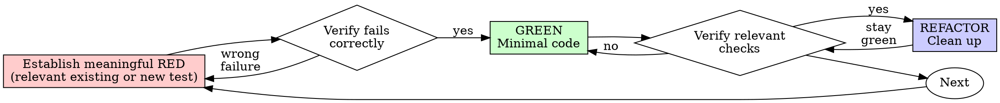

# Test-Driven Development (TDD)

## Overview

For intentional behavior changes, establish meaningful failing-test evidence before implementation, then make the relevant tests pass. For pure refactors, preserve behavior and use relevant before/after evidence, adding targeted characterization coverage before editing when existing checks do not exercise a material affected contract.

**Core principle:** Choose evidence that matches the change: demonstrate the missing behavior for intentional changes, and demonstrate preserved behavior for refactors.

**Violating the letter of the rules is violating the spirit of the rules.**

## When to Use

Use this guidance for new features, bug fixes, behavior changes, and refactoring. Intentional behavior changes require relevant failing-test evidence; pure refactors require relevant before/after evidence and targeted characterization coverage before editing when existing checks do not exercise a material affected contract. Throwaway prototypes, generated code, and configuration-only changes may lack meaningful tests; ask the operator before treating them as exceptions.

## The Behavior-Change Rule

For intentional behavior changes, establish meaningful RED before implementation: a relevant test demonstrating the missing behavior, then verify it fails for the expected reason. A relevant existing failing test may provide RED evidence only when verified before editing to fail for the intended missing behavior; do not require a new test merely to create a test diff. If it passes before edits, investigate rather than delete it.

Pure refactors do not introduce intended behavior changes, so do not invent one to force RED. Identify the affected contract, capture a pre-edit baseline, and repeat the same or demonstrably equivalent checks afterward. Add targeted characterization tests before editing when existing checks do not exercise a material affected contract; if credible evidence cannot be established, report a blocker. In either case, select tests against the changed contract, risks, and dependencies. Triage failures: distinguish regressions from pre-existing failures, do not reflexively fix unrelated old code or weaken valid assertions, and keep intentional changes separate.

## The Iron Law (Intentional Behavior Changes)

NO INTENTIONAL BEHAVIOR CODE WITHOUT A FAILING TEST FIRST. Do not keep pre-RED implementation as reference, adapt it, or reuse it; delete it and start from the verified failing test. This law applies to intentional behavior changes; pure refactors follow the baseline/refactor rule above and preserve behavior.

## Red-Green-Refactor for Intentional Behavior Changes

This cycle is the behavior-change path: begin by establishing meaningful RED with a relevant test (new or existing), then implement and verify. Pure refactors do not enter this cycle; use the [baseline/refactor workflow](#baseline-and-refactor-workflow) below.



### RED - Write Failing Test

For an intentional behavior change, establish meaningful RED: a relevant test demonstrating the missing behavior, then verify it fails for the expected reason. A relevant existing failing test is valid RED evidence; a new test is not required solely to create a test diff. Select coverage against the changed contract, risks, and dependencies. For a pure refactor, use relevant before/after evidence and add targeted characterization coverage before editing whenever existing checks do not exercise a material affected contract; do not invent a behavior change to force RED. When tests fail, triage whether the failure is introduced or pre-existing; do not reflexively fix unrelated old code or weaken valid assertions, and keep intentional behavior changes separate.

Write one minimal test showing what should happen.

<Good>
```typescript
test('retries failed operations 3 times', async () => {
  let attempts = 0;
  const operation = () => {
    attempts++;
    if (attempts < 3) throw new Error('fail');
    return 'success';
  };

  const result = await retryOperation(operation);

  expect(result).toBe('success');
  expect(attempts).toBe(3);
});
```
Clear name, tests real behavior, one thing
</Good>

<Bad>
```typescript
test('retry works', async () => {
  const mock = jest.fn()
    .mockRejectedValueOnce(new Error())
    .mockRejectedValueOnce(new Error())
    .mockResolvedValueOnce('success');
  await retryOperation(mock);
  expect(mock).toHaveBeenCalledTimes(3);
});
```
Vague name, tests mock not code
</Bad>

**Requirements:**
- One behavior
- Clear name
- Real code (no mocks unless unavoidable)

### Verify RED for Behavior Changes

For intentional behavior changes, verify meaningful RED before implementing. A relevant existing failing test may supply this evidence; it need not be a newly written test. Do not demand artificial RED for pure refactors.

```bash
npm test path/to/test.test.ts
```

Confirm:
- A test failure—not an execution error—with the expected message because the feature is missing
- If the test errors, fix the error and rerun before accepting RED

If a new test passes immediately, determine whether it already captures existing behavior; do not treat that as RED for the intended change. A test error is not evidence of the missing behavior. For pre-existing failures, record and distinguish them from failures introduced by the change.

## Baseline and Refactor Workflow

For a pure refactor, record relevant baseline behavior and verification before editing, then compare after editing; add targeted characterization coverage before editing whenever existing checks do not exercise a material affected contract. For mixed work, use meaningful RED evidence for intentional behavior changes and before/after evidence for refactors. To call a failure pre-existing and unchanged, run the same check on the relevant base revision and the changed revision, or use demonstrably equivalent checks for the same behavior; report both revisions, commands, and comparable failure evidence. Without this comparison, label the failure unverified, not pre-existing. In WSD, verified unchanged failures may be reported separately at slice handoff, not counted as passes. Standalone work has no slice-handoff exception: run required project verification and report actual results. These rules do not relax final all-pass verification gates.

## Implement, Verify, and Clean Up

### Implement and Verify the Change

For an intentional behavior change, write the simplest code to satisfy the verified failing test. For a pure refactor, preserve existing behavior; use relevant before/after checks and add targeted characterization tests before editing whenever existing checks do not exercise a material affected contract.

<Good>
```typescript
async function retryOperation<T>(fn: () => Promise<T>): Promise<T> {
  for (let i = 0; i < 3; i++) {
    try {
      return await fn();
    } catch (e) {
      if (i === 2) throw e;
    }
  }
  throw new Error('unreachable');
}
```
Just enough to pass
</Good>

<Bad>
```typescript
async function retryOperation<T>(
  fn: () => Promise<T>,
  options?: {
    maxRetries?: number;
    backoff?: 'linear' | 'exponential';
    onRetry?: (attempt: number) => void;
  }
): Promise<T> {
  // YAGNI
}
```
Over-engineered
</Bad>

Don't add features, refactor other code, or "improve" beyond the test.

### Verify Relevant Checks

Run the focused checks for the changed contract, risks, and dependencies. Report results accurately: identify pre-existing failures separately, and say the suite is green only if it passes.

```bash
npm test path/to/test.test.ts
```

Confirm and report what actually ran and its result. Do not claim other tests passed unless they were executed; identify any known pre-existing failures by name and distinguish them from new failures. A failing check or suite is not green.

If a relevant check fails, triage whether the change caused it. Fix regressions in scope; report known pre-existing failures by name without reflexively changing unrelated code or weakening valid assertions. Run the full project-required verification suite before completion and report any failures; a failure is never described as green.

### REFACTOR - Clean Up

After relevant checks pass, preserve every verified passing check during cleanup.
- Remove duplication
- Improve names
- Extract helpers

Preserve behavior during refactoring. Don't add behavior unless it is separately specified and tested.

### Repeat

For the next intentional behavior change, establish relevant failing-test evidence; for refactoring, use evidence appropriate to behavior preservation.

## Good Tests

| Quality | Good | Bad |
|---------|------|-----|
| **Minimal** | One thing. "and" in name? Split it. | `test('validates email and domain and whitespace')` |
| **Clear** | Name describes behavior | `test('test1')` |
| **Shows intent** | Demonstrates desired API | Obscures what code should do |

## Why Order Matters

**"I'll write tests after to verify it works"**

Tests written after code pass immediately. Passing immediately proves nothing:
- Might test wrong thing
- Might test implementation, not behavior
- Might miss edge cases you forgot
- You never saw it catch the bug

Test-first forces you to see the test fail, proving it actually tests something.

**"I already manually tested all the edge cases"**

Manual testing is ad-hoc. You think you tested everything but:
- No record of what you tested
- Can't re-run when code changes
- Easy to forget cases under pressure
- "It worked when I tried it" ≠ comprehensive

Automated tests are systematic. They run the same way every time.

**"Deleting X hours of work is wasteful"**

Sunk cost fallacy. The time is already gone. Your choice now:
- Delete and rewrite with TDD (X more hours, high confidence)
- Keep it and add tests after (30 min, low confidence, likely bugs)

The "waste" is keeping code you can't trust. Working code without real tests is technical debt.

**"TDD is dogmatic, being pragmatic means adapting"**

TDD IS pragmatic:
- Finds bugs before commit (faster than debugging after)
- Prevents regressions (tests catch breaks immediately)
- Documents behavior (tests show how to use code)
- Enables refactoring (change freely, tests catch breaks)

"Pragmatic" shortcuts = debugging in production = slower.

**"Tests after achieve the same goals - it's spirit not ritual"**

No. Tests-after answer "What does this do?" Tests-first answer "What should this do?"

Tests-after are biased by your implementation. You test what you built, not what's required. You verify remembered edge cases, not discovered ones.

Tests-first force edge case discovery before implementing. Tests-after verify you remembered everything (you didn't).

30 minutes of tests after ≠ TDD. You get coverage, lose proof tests work.

## Common Rationalizations

| Excuse | Reality |
|--------|---------|
| "Too simple to test" | Simple code breaks. Test takes 30 seconds. |
| "I'll test after" | Tests passing immediately prove nothing. |
| "Tests after achieve same goals" | Tests-after = "what does this do?" Tests-first = "what should this do?" |
| "Already manually tested" | Ad-hoc ≠ systematic. No record, can't re-run. |
| "Deleting X hours is wasteful" | Sunk cost fallacy. Keeping unverified code is technical debt. |
| "Keep as reference, write tests first" | You'll adapt it. That's testing after. Delete means delete. |
| "Need to explore first" | Fine. Throw away exploration, start with TDD. |
| "Test hard = design unclear" | Listen to test. Hard to test = hard to use. |
| "TDD will slow me down" | TDD faster than debugging. Pragmatic = test-first. |
| "Manual test faster" | Manual doesn't prove edge cases. You'll re-test every change. |
| "Existing code has no tests" | You're improving it. Add tests for existing code. |

## Red Flags

- Code before test
- Test after implementation
- A test that passes before implementation: investigate whether it actually tests the intended missing behavior; do not delete a valid test.
- Can't explain why test failed
- Tests added "later"
- Rationalizing "just this once"
- "I already manually tested it"
- "Tests after achieve the same purpose"
- "It's about spirit not ritual"
- "Keep as reference" or "adapt existing code"
- "Already spent X hours, deleting is wasteful"
- "TDD is dogmatic, I'm being pragmatic"
- "This is different because..."

**For intentional behavior code written before valid RED, stop and discard that code rather than reusing it as a reference; restart with the failing test.** A test that passes before implementation is investigated, not deleted. Pure refactors follow the baseline/refactor workflow, not this rule.

## Example: Bug Fix

**Bug:** Empty email accepted

**RED**
```typescript
test('rejects empty email', async () => {
  const result = await submitForm({ email: '' });
  expect(result.error).toBe('Email required');
});
```

**Verify RED for Behavior Changes**
```bash
$ npm test
FAIL: expected 'Email required', got undefined
```

**GREEN**
```typescript
function submitForm(data: FormData) {
  if (!data.email?.trim()) {
    return { error: 'Email required' };
  }
  // ...
}
```

**Verify Relevant Checks**
```bash
$ npm test
PASS
```

**REFACTOR**
Extract validation for multiple fields if needed.

## Verification Checklist
When RED setup or assertion is broken, repair the test and rerun it before implementation. When a valid assertion exposes a regression, fix the implementation—not the assertion—and rerun. Implement the minimum change to pass, then run the full project-required suite before completion.


Before marking work complete:

- [ ] Full project-required suite was run and passed before completion, except at WSD slice handoff when the documented unchanged-baseline-failure exception applies; final completion still requires the full suite to pass.

- [ ] For each intentional behavior change, relevant tests demonstrate the missing behavior and were verified failing for the expected reason before implementation (a relevant existing failing test may provide this evidence).
- [ ] For pure refactors, relevant before/after evidence is recorded; when existing checks do not exercise a material affected contract, targeted characterization coverage was added before editing. No artificial behavior change or RED is required.
- [ ] For mixed work, provide both behavior-change and refactor evidence for the corresponding changes.
- [ ] Tests are selected against the changed contract, risks, and dependencies; test meaningful behavior, not necessarily every helper or function.
- [ ] Failures are triaged as introduced or pre-existing; valid assertions are preserved and unrelated old code is not reflexively changed.
- [ ] Report verification accurately. Name known pre-existing failures; do not claim the suite is green unless it passes.
- [ ] Tests use real code (mocks only if unavoidable).
- [ ] Edge cases and errors relevant to the changed contract are covered.

## When Stuck

| Problem | Solution |
|---------|----------|
| Don't know how to test | Write wished-for API. Write assertion first. Ask the user. |
| Test too complicated | Design too complicated. Simplify interface. |
| Must mock everything | Code too coupled. Use dependency injection. |
| Test setup huge | Extract helpers. Still complex? Simplify design. |

## Debugging Integration

Bug found? Write failing test reproducing it. Follow TDD cycle. Test proves fix and prevents regression.

Never fix bugs without a test.

## Testing Anti-Patterns

When adding mocks or test utilities, read [testing-anti-patterns.md](testing-anti-patterns.md) to avoid common pitfalls:
- Testing mock behavior instead of real behavior
- Adding test-only methods to production classes
- Mocking without understanding dependencies

## Final Rule

```
Intentional behavior change → relevant test failed first for the expected reason
Pure refactor → relevant behavior preserved with before/after evidence
Otherwise → not TDD
```

Exceptions require operator approval. Inside `solopowers:workstream-driven-development`, a fix that already landed without RED follows that skill's cannot-verify ladder: a controller-reconstructed RED stands in for discard-and-redo (a controller-side rule; workers still observe RED before editing); otherwise the operator decides keep or re-dispatch. The discard-not-reuse rule applies to intentional behavior code written before valid RED, not refactors or tests that pass before implementation. For standalone work and final completion, all applicable checks must pass. Only at WSD slice handoff may a verified unchanged baseline failure be reported; establish it on both the relevant base and changed revision with equivalent checks and report both results. Check for unexpected errors or warnings and correct unmet applicable checks.
