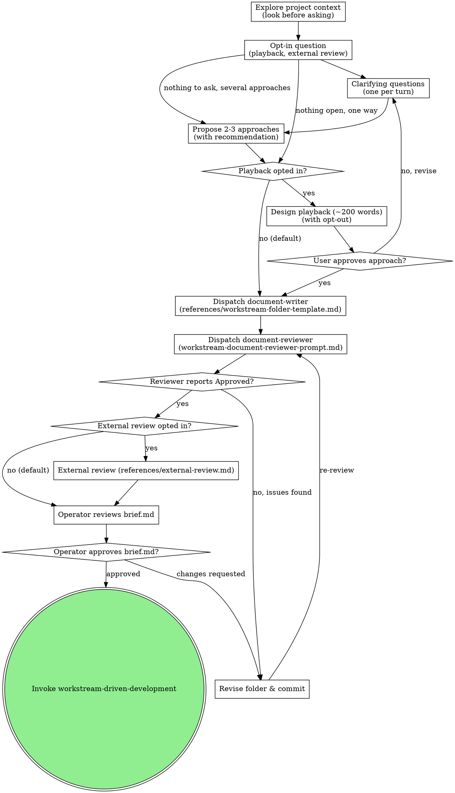

# Workstream Brainstorming

Help turn ideas into fully formed designs and sequential execution slices through natural collaborative dialogue, culminating in a canonical **workstream folder** whose one-screen `brief.md` is the only file the operator approves.

People often haven't finished working out everything they want. Good questions help them think it through. When you understand the underlying purpose, you can make the hundreds of small decisions they never mention the way they would have made them.

<HARD-GATE>
Do NOT invoke any implementation skill, write any code, scaffold any project, or take any implementation action until you have presented a design/workstream and the user has approved it. This applies to EVERY project regardless of perceived simplicity.
</HARD-GATE>

## Anti-Pattern: "This Is Too Simple To Need A Design"

Every project goes through this process. A single-function utility, a config change, a small refactoring — all of them. "Simple" projects are where unexamined assumptions cause the most wasted work. The design can be short for truly simple projects, but you MUST present it (via `brief.md`, or the playback if opted in) and get user approval.

## First: Look Before You Ask

In an existing project, or when the user has provided context (docs, issue descriptions, code pointers, recent commits), inspect repository state first before asking questions. Read until you understand how relevant parts work today and what this change would touch. **Never ask what the codebase or existing docs already answer.** Do recon instead of offering it: go look deeper (code, files, or the web) and say what you looked for and found. Never reopen what the user has already decided.

## Question Craft and Conversational Rhythm

- **Ask only when it changes the build:** Ask a question only when the answer would change what gets built and neither the request nor the project answers it. Otherwise state your call and reason as a proposal the user can correct, and move forward.
- **One question per turn:** When you ask, end the message with exactly one focused question; a message that just states your call or proceeds needs none. Do not bury questions in long paragraphs or append open-ended lists of alternatives to a question.
- **Open questions first:** If the user hasn't said why they want it, ask that first, even if you can guess: one open question in their own terms, with no example answers. Use open questions for intent, core problems, and success criteria; let their words guide the design. Never add a second question in the same turn.
- **Options only when bounded:** Once the why is known and a choice can be named, sketch each option concretely enough to picture, with its trade-offs and your recommendation. Do this only for a genuine, bounded set of alternatives (e.g. database choices, protocol variants); never manufacture options for open questions. If the user has handed over the how, say you'll go with your pick.
- **Recommend when deferred:** When the user says "you decide", "just guess", or defers a choice, do not bounce the question back. Make a concrete pick, state it with brief rationale as your call, and move forward; the user can still correct it.
- **Understand how it gets made:** Read from how the user talks whether they want to discuss technical choices (give options with your pick) or hand them over (decide, and state each in one line). When there's existing work, build on what it already uses. Choices the user hasn't confirmed go in the document as your calls, not as agreed decisions.
- **Process is your call:** Where supporting files go (the workstream folder's location is fixed: `docs/workstreams/YYYY-MM-DD-<topic>/`), whether to look further, how to show something, and dispatching the writer or reviewer are yours: state them, don't ask (the internal review itself is mandatory). Approval of `brief.md` (and of the design, only if playback was opted in) stays the user's.
- **Show, don't tell:** Whenever seeing would help more than reading (a screen, a page, a layout, a schedule), sketch it in a few lines of text next to the description.
- **Socratic probing:** Build each question on their last answer or on what you discovered in the codebase, helping them think through edge cases and failure modes.

## Exploring Approaches

Once you understand what the user wants, and before drafting the workstream folder:
- Propose 2–3 distinct approaches grounded in the codebase.
- State clear trade-offs for each option (complexity, maintenance burden, performance, risk).
- Lead with your recommended option and why.
- If the user wants to discuss technical choices, ask which direction they prefer; otherwise say you'll go with your pick. When there is genuinely only one sensible way forward, state that clearly and explain why alternatives are ill-suited.

## Opt-Ins: Playback and External Review (Both Off by Default)

Right after context exploration, before any clarifying question, ask the opt-in question as its OWN turn (one question, no other question in that turn): does the operator want (a) a design playback and approval before drafting, and (b) external review of the drafted folder. State your recommendation (skip or opt in) and a one-line reason for each, based on the workstream's size and risk. The operator decides; if they don't care, both are off. Wording, recommendation heuristics, and the `log.md` record: [references/opt-ins.md](references/opt-ins.md).

## Design Playback (Opt-In, ~200 Words)

**Playback off:** go from the clarified scope (and chosen approach) straight to drafting the folder. Your only approval gate is `brief.md`.

**Playback on:** before drafting, present a concise (~200-word) playback:
- The objective and architecture: agreed ones, or proposed ones when nothing was open
- Key design decisions: the user's settled ones, with your unconfirmed calls marked as your calls
- The proposed sequential slice breakdown

End it with its single approval question, which doubles as the opt-out: *"Shall I draft the workstream folder from this, or adjust something first?"* If the user says "just write it", proceed directly to drafting. If they said it before seeing the approach, still send the playback, but end it with *"Drafting the workstream folder from this now."* instead of the question, then proceed without waiting. "Just write it" skips only the playback approval; the internal review and the user's review of `brief.md` still apply. For small tasks the playback is short, but still wait for approval.

## Sizing the Work and Slices

- **Decompose into sequential slices:** Break the work into sequential milestones (e.g., Slice A, Slice A1, Slice A2). Slice IDs use `[A-Z][0-9]*`; IDs do not establish ordering. Each slice represents a clean milestone that can be independently developed, compiled, and tested.
- **Slice sizing principles:** Slices are executed by standard-tier workers with limited context. Each slice should touch 1–5 files and carry its own TDD cycle (failing test → minimal implementation → verification). If a slice requires extensive explanation to be unambiguous, it is too large — split it.
- **No implementation code in the document:** Key file paths, interfaces, column names, schema definitions, test targets, and exact verification commands belong in the slices, but raw code generation is offloaded entirely to the slice implementer.
- **Decision completeness:** All design choices that would require rework if decided wrong MUST be settled in the folder. Incidental choices (internal helpers, variable names, log message wording) are explicitly left to implementation discretion.

## The Canonical Workstream Folder

We explicitly do NOT split design and implementation planning into separate artifacts. Instead, we capture both in a single **workstream folder** written under `docs/workstreams/YYYY-MM-DD-<topic>/` with three files:

1. **`brief.md`** (the operator's file, the only one they approve; one screen, about 40 lines max, no tables): title/date/status; Why; Happy path and acceptance boundary (testable bullets); Key decisions as one-line bullets (`decision — why`); Open questions; Final smoke checks (only P0/P1 checks agents cannot perform or are not authorized to perform, else `None`); Pointers to `slices.md` and `log.md`.
2. **`slices.md`** (agents only, as verbose as needed): agent preamble (Objective, scope in/out, key files, architecture invariant, fuller assumptions and design decisions, implementation discretion, unresolved blockers, final-verification commands) followed by the sequential slices (`### Slice <ID>: <title>`, ID `[A-Z][0-9]*`) with Goal, TDD Tasks, Watch out, Verification, and Carry-forward.
3. **`log.md`** (agents only): created with the header `# <Topic> Workstream Log` and one line `Opt-ins: playback=<on|off>, external review=<on|off>`; the execution skill appends only `Isolation:` (after the Opt-ins line), `Pre-flight:`, `Smoke:` lines, the `Final review:` outcome and the `P2/P3:` entry.

For the full markdown schema, section requirements, and examples, read [references/workstream-folder-template.md](references/workstream-folder-template.md).

## Process Checklist

You MUST create a task for each of these items and complete them in order:

1. **Explore project context** — check files, docs, recent commits (look before asking). Then ask the opt-in question (playback, external review) as its own turn, before any clarifying question.
2. **Clarifying questions** — one question per turn, open questions first. May be empty: when the why is known and nothing that changes the build is open, go straight to step 3. (Skipped with step 3 when nothing is open and there is one sensible way.)
3. **Propose 2–3 approaches** — with trade-offs and your recommendation.
4. **Design playback (~200 words)** — only if opted in; concise playback with opt-out before drafting. Otherwise go straight to step 5.
5. **Write workstream folder** — dispatch a `document-writer` subagent to write `brief.md`, `slices.md`, and `log.md` under `docs/workstreams/YYYY-MM-DD-<topic>/` following [references/workstream-folder-template.md](references/workstream-folder-template.md) and commit. Pass the opt-ins (playback, external review; both off if unanswered) so the writer records them in `log.md`.
6. **Mandatory Internal Document Review** — dispatch a `document-reviewer` subagent using `skills/workstream-brainstorming/workstream-document-reviewer-prompt.md`. This in-process gate is strict and never optional: evaluate adversarial probes and the **builder perspective** ("what would a slice implementer have to guess?"). Revise accepted issues and re-review until `Approved`. Commit the resulting workstream folder.
7. **External review (only if opted in)** — after the internal reviewer reports `Approved` and before the operator sees `brief.md`, run the supplemental External Harness Review on the folder (see below and [references/external-review.md](references/external-review.md)).
8. **Operator reviews `brief.md`** — ask the operator to review and approve ONLY `brief.md`; `slices.md` and `log.md` need no approval.
9. **Transition to implementation** — invoke `solopowers:workstream-driven-development`.

## Process Flow

**The terminal state is invoking solopowers:workstream-driven-development.** Do NOT invoke `writing-plans` or standard implementation skills.

## Platform-Specific Subagent Dispatch

Model tier: document-reviewer and builder-check use the strongest tier; document-writer uses the standard tier (definitions: `solopowers:workstream-driven-development` Roles and Model Selection; tier table: `solopowers:workstream-driven-development` `references/harness-dispatch.md`). Specify the tier explicitly; an omitted model inherits the controller's.

Use the table below to dispatch document-writer and document-reviewer subagents on your harness:

| Platform | Dispatch document-writer | Dispatch document-reviewer |
|---|---|---|
| Pi | built-in `delegate` role (`context: "fork"`) | built-in `oracle` role (`context: "fresh"`) |
| kiro-cli | `orchestrate_subagent(role: plan-composer)` | `orchestrate_subagent(role: architecture-oracle)` |
| claude-code | `Task` tool with document-writer prompt | `Task` tool with document-reviewer prompt |
| Antigravity | describe the document-writing task in natural language | describe the adversarial review task in natural language |

## Mandatory Internal Review & The Builder Perspective

The mandatory internal document review is Harness A’s in-process, read-only gate. Dispatch it with `workstream-document-reviewer-prompt.md`; its result is `Approved | Issues Found`.

In addition to standard compliance checks, the review evaluates the document from the **builder perspective**:
- *Read this as the subagent implementing each slice without talking to the author: what would you have to guess?*
- *Which file paths, interfaces, data models, error states, or test commands are ambiguous or missing?*
- *Where would an ambiguous requirement lead to rework or architectural drift?*

Address any findings, commit the updated workstream folder, and re-review until the reviewer reports `Approved`. (For ad-hoc standalone probing, `builder-check-prompt.md` is also available).

## Optional External Harness Review (Opt-In)

Runs only if the operator opted in (default off), after the internal reviewer approves and before the operator reviews `brief.md`. It reviews the workstream folder (`brief.md` + `slices.md`; `log.md` excluded). Harness A owns brainstorming, internal review, commits, package creation, report verification, finding adjudication, and WDD handoff. Harness B is an independent, user-launched reviewer session with no direct bridge; it reads only Git objects anchored at the package commit.

Run these helpers by their absolute path, from the working tree you're executing in (never `cd` into the skill directory):
- `bash scripts/external-review-workspace WORKSTREAM_FOLDER`
- `bash scripts/external-review-package initial WORKSTREAM_FOLDER`
  After it runs, in the same message and unprompted, quote the launch block (contents of `LAUNCH_FILE`) verbatim, including the 'Launch Harness B with:' header line, in a fenced code block, in the same message, unprompted, for the operator to paste into Harness B.
- `external-workstream-document-reviewer-prompt.md`
- `bash scripts/external-review-report publish PACKAGE DRAFT`
- `bash scripts/external-review-report verify PACKAGE REPORT`

For full protocol details, state machine transitions, package format, and confirmation package handling, read [references/external-review.md](references/external-review.md).

## Handoff to Implementation

Once the folder has passed internal review and then external review (if opted in), present `brief.md` to the operator:

> "Workstream folder written and committed to `docs/workstreams/YYYY-MM-DD-<topic>/`. Please review `brief.md` (the only file that needs your approval) and let me know if you want any changes before we transition to `workstream-driven-development`."

Wait for approval of `brief.md`. Once approved, set its `**Status**` to `Approved` and commit that path, then invoke `solopowers:workstream-driven-development`, handing over the workstream folder path; execution uses `<folder>/slices.md`, reads `<folder>/brief.md` for the acceptance boundary and final smoke checks, and writes `<folder>/log.md`.
