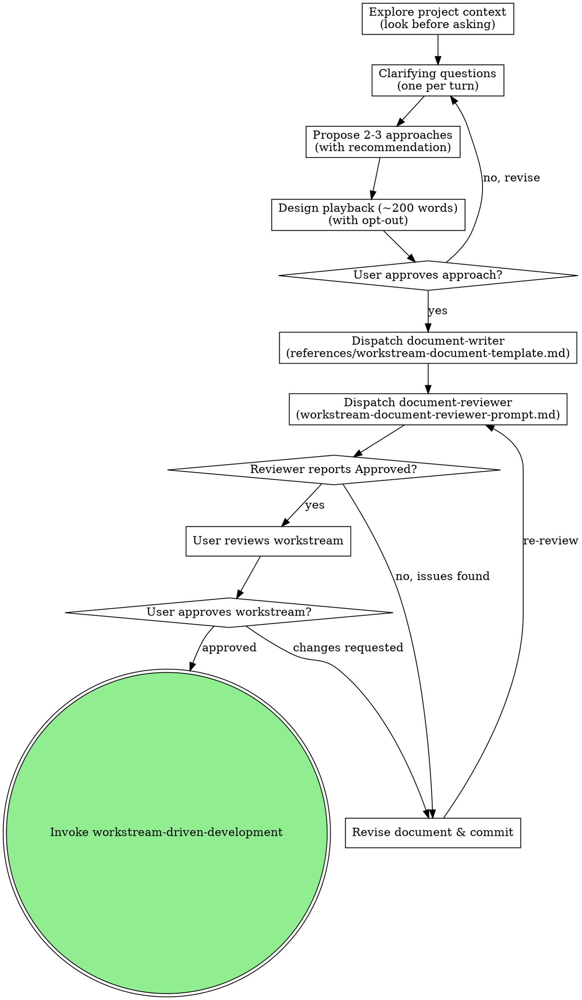

# Workstream Brainstorming

Help turn ideas into fully formed designs and sequential execution slices through natural collaborative dialogue, culminating in a single canonical **Workstream Document**.

People often haven't finished working out everything they want. Good questions help them think it through. When you understand the underlying purpose, you can make the hundreds of small decisions they never mention the way they would have made them.

<HARD-GATE>
Do NOT invoke any implementation skill, write any code, scaffold any project, or take any implementation action until you have presented a design/workstream and the user has approved it. This applies to EVERY project regardless of perceived simplicity.
</HARD-GATE>

## Anti-Pattern: "This Is Too Simple To Need A Design"

Every project goes through this process. A single-function utility, a config change, a small refactoring — all of them. "Simple" projects are where unexamined assumptions cause the most wasted work. The design can be short for truly simple projects, but you MUST present it and get user approval.

## First: Look Before You Ask

In an existing project, or when the user has provided context (docs, issue descriptions, code pointers, recent commits), inspect repository state first before asking questions. Read until you understand how relevant parts work today and what this change would touch. **Never ask what the codebase or existing docs already answer.**

## Question Craft and Conversational Rhythm

- **One question per turn:** End each conversational message with exactly one focused question. Do not bury questions in long paragraphs or append open-ended lists of alternatives to a question.
- **Open questions first:** Use open questions when exploring user intent, core problems, and success criteria. Allow the user's own words to guide the design rather than constraining them prematurely.
- **Multiple-choice only when bounded:** Offer multiple-choice menus only when there is a genuine, bounded set of technical or architectural alternatives (e.g. database choices, protocol variants). Do not manufacture artificial multiple-choice options for open questions.
- **Recommend when deferred:** When the user says "you decide", "just guess", or defers a choice, do not bounce the question back. Propose a concrete recommendation with brief rationale and ask for confirmation.
- **Understand how it gets made:** Clarify constraints around runtime, languages, external dependencies, and architectural boundaries early.
- **Socratic probing:** Build each question on their last answer or on what you discovered in the codebase, helping them think through edge cases and failure modes.

## Exploring Approaches

Once you understand what the user wants, and before drafting the Workstream Document:
- Propose 2–3 distinct approaches grounded in the codebase.
- State clear trade-offs for each option (complexity, maintenance burden, performance, risk).
- Lead with your recommended option and explain why.
- Ask the user which direction they prefer. When there is genuinely only one sensible way forward, state that clearly and explain why alternatives are ill-suited.

## Concise Design Playback (~200 Words) With Opt-Out

Before writing the full Workstream Document on non-trivial workstreams, present a concise (~200-word) playback summarizing:
- The agreed objective and architecture
- Key settled design decisions
- The proposed sequential slice breakdown

Include a light opt-out so the user can fast-path: *"If this looks right, I'll proceed with drafting the Workstream Document. Or if you'd like me to adjust the approach, let me know."* If the user says "just write it" or the task is small and straightforward, proceed directly to writing the Workstream Document.

## Sizing the Work and Slices

- **Decompose into sequential slices:** Break the work into sequential milestones (e.g., Slice A, Slice A1, Slice A2). Slice IDs use `[A-Z][0-9]*`; IDs do not establish ordering. Each slice represents a clean milestone that can be independently developed, compiled, and tested.
- **Slice sizing principles:** Slices are executed by low-cost models with limited context windows. Each slice should touch 1–5 files and carry its own TDD cycle (failing test → minimal implementation → verification). If a slice requires extensive explanation to be unambiguous, it is too large — split it.
- **No implementation code in the document:** Key file paths, interfaces, column names, schema definitions, test targets, and exact verification commands belong in the document, but raw code generation is offloaded entirely to the slice implementer.
- **Decision completeness:** All design choices that would require rework if decided wrong MUST be settled in the document. Incidental choices (internal helpers, variable names, log message wording) are explicitly left to implementation discretion.

## The Canonical Workstream Document

We explicitly do NOT split design and implementation planning into separate documents. Instead, we capture both in a single **Workstream Document** written under `docs/workstreams/YYYY-MM-DD-<topic>.md`.

The document defines:
1. **Metadata:** Title, Date, Status (Planned), Merged (target branch), Objective.
2. **Context:** Problem, Approved simplification, Target behaviour, Deliberate simplification, Architecture invariant, Design decisions and assumptions table, Implementation discretion, Unresolved design blockers.
3. **Workstream scope:** In scope, Out of scope.
4. **Key files:** Table of files, packages, and current roles.
5. **Scoped workstream slices:** Sequential slices (`[A-Z][0-9]*`) with Goals, TDD Tasks, Watch out, Verification, Manual smoke test, and Carry-forward.
6. **Final verification:** Project-wide checks (test suite, typecheck, lint, format).
7. **Success criteria:** Testable outcomes.

For the full markdown schema, section requirements, and examples, read [references/workstream-document-template.md](references/workstream-document-template.md).

## Process Checklist

You MUST create a task for each of these items and complete them in order:

1. **Explore project context** — check files, docs, recent commits (look before asking).
2. **Clarifying questions** — one question per turn, open questions first.
3. **Propose 2–3 approaches** — with trade-offs and your recommendation.
4. **Design playback (~200 words)** — concise playback with opt-out before drafting.
5. **Write Workstream Document** — dispatch a `document-writer` subagent to write `docs/workstreams/YYYY-MM-DD-<topic>.md` following [references/workstream-document-template.md](references/workstream-document-template.md) and commit.
6. **Mandatory Internal Document Review** — dispatch a `document-reviewer` subagent using `skills/workstream-brainstorming/workstream-document-reviewer-prompt.md`. This in-process gate is strict and never optional: evaluate adversarial probes and the **builder perspective** ("what would a slice implementer have to guess?"). Revise accepted issues and re-review until `Approved`. Commit the resulting Workstream Document.
7. **User reviews Workstream Document** — ask user to review the workstream file. The user may optionally run the supplemental External Harness Review (see below and [references/external-review.md](references/external-review.md)).
8. **Transition to implementation** — invoke `solopowers:workstream-driven-development`.

## Process Flow

**The terminal state is invoking solopowers:workstream-driven-development.** Do NOT invoke `writing-plans` or standard implementation skills.

## Platform-Specific Subagent Dispatch

Use the table below to dispatch document-writer and document-reviewer subagents on your harness:

| Platform | Dispatch document-writer | Dispatch document-reviewer |
|---|---|---|
| Pi | built-in `delegate` role (`context: "fork"`) | built-in `oracle` role (`context: "fresh"`) |
| kiro-cli | `orchestrate_subagent(role: plan-composer)` | `orchestrate_subagent(role: architecture-oracle)` |
| claude-code | `Task` tool with document-writer prompt | `Task` tool with document-reviewer prompt |
| Antigravity | describe the document-writing task in natural language | describe the adversarial review task in natural language |

## Mandatory Internal Review & The Builder Perspective

The mandatory internal document review is Harness A’s in-process, read-only gate. Dispatch it with `workstream-document-reviewer-prompt.md`; its result is `Approved | Issues Found`.

In addition to standard compliance checks, the review evaluates the document from the **builder perspective**:
- *Read this as the subagent implementing each slice without talking to the author: what would you have to guess?*
- *Which file paths, interfaces, data models, error states, or test commands are ambiguous or missing?*
- *Where would an ambiguous requirement lead to rework or architectural drift?*

Address any findings, commit the updated Workstream Document, and re-review until the reviewer reports `Approved`. (For ad-hoc standalone probing, `builder-check-prompt.md` is also available).

## Optional External Harness Review

External review is optional and user-coordinated. Harness A owns brainstorming, internal review, commits, package creation, report verification, finding adjudication, and WDD handoff. Harness B is an independent, user-launched reviewer session with no direct bridge; it reads only Git objects anchored at the package commit.

Tools available in this skill's directory:
- `bash scripts/external-review-workspace WORKSTREAM_FILE`
- `bash scripts/external-review-package initial WORKSTREAM_FILE`
- `external-workstream-document-reviewer-prompt.md`
- `bash scripts/external-review-report publish PACKAGE DRAFT`
- `bash scripts/external-review-report verify PACKAGE REPORT`

For full protocol details, state machine transitions, and confirmation package handling, read [references/external-review.md](references/external-review.md).

## Handoff to Implementation

Once the document has passed internal review (and optional external review), present it to the user:

> "Workstream Document written and committed to `docs/workstreams/YYYY-MM-DD-<topic>.md`. Please review it and let me know if you want to make any changes before we transition to `workstream-driven-development`."

Wait for user approval. Once approved, invoke `solopowers:workstream-driven-development` to begin slice execution.
