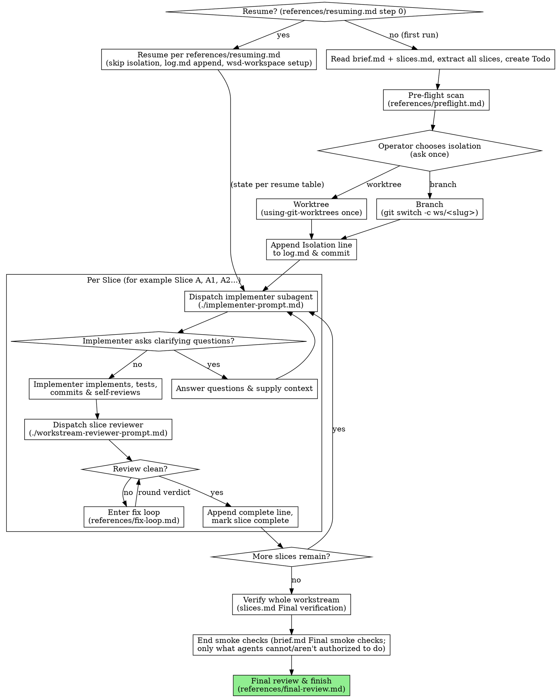

# Workstream-Driven Development

Execute a workstream folder (`brief.md`, `slices.md`, `log.md`) by dispatching a fresh subagent per slice, with a combined review after each: one reviewer returns spec compliance plus P0-P3 graded findings.

**Why subagents:** You delegate slice-level execution to specialized agents with isolated contexts. By precisely crafting their instructions, task details, and relevant file contexts, you ensure they stay focused and succeed. They should never inherit your full session history—only the curated slice requirements and file definitions.

**Core principles:**

Slice IDs use the grammar `[A-Z][0-9]*`: an uppercase letter followed by zero or more digits. For example, `A`, `A1`, and `A2` are valid IDs and are matched exactly; the IDs do not establish ordering.

1. **Single Isolation Unit**: The whole workstream runs in ONE isolation unit (a git branch or a git worktree) chosen by the operator once at the start. `finishing-a-development-branch` is called ONCE after the final slice is verified, in both modes. Never one per slice.
2. **Sequential Slice Execution**: Slices (for example, Slice A, A1, and A2) are completed one by one in document order.
3. **Curated Input**: The controller (you) extracts the slice goal, tasks, watch-outs, verification, and carry-forward from `slices.md` (checked against `brief.md`), presenting a highly focused prompt to the worker subagent.
4. **Combined Review**: For every slice, one reviewer checks requirements compliance and code quality in one pass and grades every finding P0-P3 with evidence. A slice is review clean when no P0/P1 is open.
5. **No Per-Slice Pause**: Run the worker ↔ reviewer retry loop until the slice is **review clean** (see [references/fix-loop.md](references/fix-loop.md)), write `complete`, continue. Human smoke testing happens once, at the end ([references/end-smoke.md](references/end-smoke.md)).

## When to Use

Use this skill when you have an approved **workstream folder** (e.g., `docs/workstreams/YYYY-MM-DD-<topic>/` containing `brief.md`, `slices.md`, and `log.md`) and are ready to begin implementation.

## The Process

*Diagram labels describe workflow roles; see Harness Dispatch below for your harness.*

## Prompt Templates and Scripts

The following templates and helper scripts are stored in this skill's directory:

- `WORKSTREAM_FILE` is always `<folder>/slices.md`; for `review-package`, `<workspace-slug>` is the folder name minus its leading `YYYY-MM-DD-`.
- `implementer-prompt.md` - Dispatch prompt for the implementer subagent.
- `workstream-reviewer-prompt.md` - Dispatch prompt for the slice reviewer subagent.
- `re-review-prompt.md` - Scoped re-review prompt used during fix loops.
- Run each helper below by its absolute path, from the working tree you're executing in (never `cd` into the skill directory).
- `bash scripts/slice-brief WORKSTREAM_FILE SLICE_ID` - Extracts a single slice into an isolated brief file.
- `bash scripts/review-package BASE HEAD <workspace-slug> WORKSTREAM_FILE` - Generates a unified diff package for reviewers.
- `bash scripts/wsd-workspace WORKSTREAM_FILE` - Resolves the disambiguated workstream workspace directory.

## Supporting References

Detailed procedures that the controller reads fresh at specific workflow steps live in `references/`:

- [references/preflight.md](references/preflight.md) - Pre-flight scan of `brief.md` and `slices.md` before Slice 1.
- [references/fix-loop.md](references/fix-loop.md) - Bounded 4-round fix loop, P2/P3 logging, escalation if a P0/P1 persists at the cap, and test rules.
- [references/end-smoke.md](references/end-smoke.md) - Single end-of-workstream smoke step for P0/P1 checks agents cannot do.
- [references/final-review.md](references/final-review.md) - Final whole-workstream review, no second fix wave, and cleanup.
- [references/isolation.md](references/isolation.md) - Branch-or-worktree choice, branch-mode rules, `log.md` setup.
- [references/harness-dispatch.md](references/harness-dispatch.md) - Per-harness subagent dispatch and escalation tables.
- [references/reviewer-prompts.md](references/reviewer-prompts.md) - Rules for filling the reviewer prompt template, incl. `[SEVERITY_DEFINITIONS]`.
- [references/resuming.md](references/resuming.md) - Durable progress ledger, workspace identity, header parsing, isolation mode from `log.md`, and session resume.
- [references/handling-reports.md](references/handling-reports.md) - Handling non-DONE worker statuses (`BLOCKED`, `NEEDS_CONTEXT`, `DONE_WITH_CONCERNS`).
- [references/cannot-verify.md](references/cannot-verify.md) - Resolving "⚠️ Cannot verify from diff" reviewer items.

## Required Sub-skills

Workers MUST use:

- `solopowers:test-driven-development` - Mandatory for every slice. The worker must follow a real red → green cycle and provide evidence for it in the slice report.

## Roles and Model Selection

- **Controller (You)**: Oversees execution, manages slice-to-slice state, updates the Todo task list, curates file contexts, and coordinates reviews. (The session's own model.)
- **Implementer and fixer subagents:** Implement and test a single slice, or fix review findings. (Standard tier.)
- **Slice Reviewer, re-reviewer, and final reviewer subagents:** Evaluate requirements compliance AND code quality in a single pass. Return spec compliance (✅/❌/⚠️) and P0-P3 findings. (Strongest tier.)

Tiers: **strongest** is the most capable model the harness offers; **standard** is the capable mid-tier model, cheaper than strongest. Always specify the tier explicitly when dispatching a subagent. An omitted model silently inherits the controller's session model. Tier-to-model mapping per harness: [references/harness-dispatch.md](references/harness-dispatch.md).

**Turn count beats token price.** Cheap models take many more turns on multi-step work and cost more overall. Workers get the standard tier; reviewers get the strongest tier. Do not route reviews to cheaper tiers, even for small fix diffs.

## Harness Dispatch

How to dispatch implementer and reviewer subagents, and how they escalate, per harness: [references/harness-dispatch.md](references/harness-dispatch.md).

## Handling Worker Status

Worker subagents report one of four statuses: `DONE`, `DONE_WITH_CONCERNS`, `NEEDS_CONTEXT`, or `BLOCKED`. For complete handling instructions for non-DONE statuses, read [references/handling-reports.md](references/handling-reports.md).

When `DONE`: Generate the review package (`bash scripts/review-package BASE HEAD <workspace-slug> WORKSTREAM_FILE`) and dispatch the slice reviewer.

## Execution Flow

### 1. Resume Check, then Initial Set Up

- **Resume check (FIRST, before pre-flight, the isolation choice, `log.md` append, or any `wsd-workspace` call).** Follow step 0 of [references/resuming.md](references/resuming.md) (`git worktree list`, `ws/<slug>` branch, `Isolation:` line in `log.md`) to see whether a unit exists (a `Final review: clean (at <h7>)` line in its `log.md` means finished: no workspace call, no dispatch). If so, this is a RESUME: follow `references/resuming.md` and SKIP only this section's isolation choice, `log.md` append and `wsd-workspace` bullets (redo pre-flight only if `log.md` has no `Pre-flight:` line). If no unit exists, it is a first run: continue below.

- Read `<folder>/brief.md` (acceptance boundary, final smoke checks) and `<folder>/slices.md` (preamble: key files, invariant, assumptions, final-verification commands; then the slices). Extract all slices, then create a `todo` task list: one task per slice, plus "Final verification and close branch".
- Run the pre-flight scan over `brief.md` and `slices.md` (see [references/preflight.md](references/preflight.md)) and surface findings before the isolation choice; agreed edits happen inside the unit, and the result goes to `log.md` after isolation setup.
- **Isolation choice (ask ONCE per workstream, never again on resume).** Agent recommends worktree or branch with a one-line reason; the operator decides. Worktree mode invokes `solopowers:using-git-worktrees` ONCE; branch mode is handled inline (clean tree, never on the default branch, `git switch -c ws/<slug>`). See [references/isolation.md](references/isolation.md).
- Right after isolation setup, APPEND `Isolation: <branch|worktree> — branch <name>` after the existing lines of `<folder>/log.md` (brainstorming created it; do not re-create) and commit it inside the isolation unit as its first commit (never on the default branch), then the pre-flight result (see [references/isolation.md](references/isolation.md)).
- Resolve the workspace with `bash scripts/wsd-workspace <folder>/slices.md` (records the path in the ledger header; disambiguates slug collisions).
- `progress.md` (gitignored, in `.solopowers/wsd/<slug>/`) is the source of truth for slice state; `log.md` is the committed human/agent record. Completed slices are never re-dispatched.

### 2. Dispatching the Worker

For each slice, dispatch the worker subagent using file handoffs:

- Generate a slice brief with `bash scripts/slice-brief WORKSTREAM_FILE SLICE_ID` and pass the printed file path to the worker. `SLICE_ID` must match `[A-Z][0-9]*` (e.g., `A`, `A1`, `A2`).
- Explicitly inject `solopowers:test-driven-development` into the worker dispatch.
- **Test execution rule:** Run covering tests per fix round; run the full repository test suite before reporting slice DONE and before final workstream review.
- Provide the Objective (from the `slices.md` preamble), in-scope details, and carry-forward context from the preceding completed slice.
- Name a report file path for the worker so detailed notes and test evidence live on disk, not in controller context.
- Provide only the relevant code files or interfaces for this slice.

**Context budget:** The curated prompt must fit comfortably in a small context window. If a slice's brief + carry-forward + files exceed what a standard-tier worker can hold, escalate to the user — the slice is too large and needs splitting in `slices.md`.

### 3. Reviewing the Slice

- Once the worker reports `DONE` or `DONE_WITH_CONCERNS`, generate a diff package with `bash scripts/review-package BASE HEAD <workspace-slug> WORKSTREAM_FILE` and dispatch the reviewer subagent.
- The reviewer checks the diff and reported TDD evidence, returning spec compliance (✅/❌/⚠️), P0-P3 findings with evidence, and `Verdict: CLEAN` or `NEEDS FIXES`.
- If the reviewer reports "⚠️ Cannot verify from diff", resolve it yourself from context before marking the slice review clean (see [references/cannot-verify.md](references/cannot-verify.md)).
- If the verdict is NEEDS FIXES (open P0/P1): enter the bounded fix loop (see [references/fix-loop.md](references/fix-loop.md)). Re-read `references/fix-loop.md` before every fix round.
- When the slice is **review clean**, append `Slice <ID>: complete (commits <base7>..<head7>, review clean[, <K> user rulings])` to the ledger, mark it complete in the Todo list, and continue. No pause.

### 4. Transitioning and Finalization

When all slices are marked complete:
- Follow [references/final-review.md](references/final-review.md): run the **Final verification** commands from the `slices.md` preamble, check against `brief.md`, run the end smoke step ([references/end-smoke.md](references/end-smoke.md)), generate the whole-branch review package, dispatch the final codebase reviewer (`solopowers:dispatching-code-review`), clean up the workspace directory, and invoke `solopowers:finishing-a-development-branch`.

## File Handoffs

Everything pasted into a prompt or returned by a subagent stays resident in your context for the rest of the session. Prefer artifacts on disk:

- **Slice brief:** `bash scripts/slice-brief WORKSTREAM_FILE SLICE_ID` extracts one slice into its own file.
- **Worker report:** Give each slice a report file path. The worker writes the full report and test evidence there, returning only status, commits, test summary, concerns, and the report path.
- **Review package:** `bash scripts/review-package BASE HEAD <workspace-slug> WORKSTREAM_FILE` writes the commit list, stat summary, and diff context into one file.

## Constructing Reviewer Prompts

Rules for filling the reviewer template (slice-scoped, no pre-judging, diff as a file): [references/reviewer-prompts.md](references/reviewer-prompts.md). Read before every reviewer dispatch.

## Durable Progress and Session Resume

Conversation memory does not survive compaction. Track durable progress in `$(bash scripts/wsd-workspace <workspace-slug> WORKSTREAM_FILE)/progress.md`.

For complete details on ledger header tracking, collision disambiguation (`<slug>-<date>[-N]`), legacy ledger adoption, and step-by-step resume instructions, read [references/resuming.md](references/resuming.md).

- Write the `complete` line (Execution Flow step 3) immediately when the slice is review clean. Slices with a `complete` line are DONE — do not re-dispatch them.
- On resume, read the ledger, inspect git log in the isolation unit, and resume execution per the state table in [references/resuming.md](references/resuming.md).

## Red Flags / Anti-patterns

- **Creating a new branch or worktree per slice**: Absolutely NOT. One isolation unit for the entire workstream.
- **Re-asking the isolation choice or committing onto the default branch**: Ask once; on resume read `log.md`. Never commit workstream work to the default branch.
- **Letting subagents read the workstream folder**: Subagents do NOT read `brief.md` or `slices.md`. Provide the curated text and tasks for their specific slice to protect their context window.
- **Treating TDD as optional**: Do not dispatch workers without `solopowers:test-driven-development`, and do not accept "tests added later" as equivalent to a real red → green cycle.
- **Proceeding while a slice review fails**: Never start the next slice while a P0/P1 is open in the current slice.
- **Failing to commit**: Ensure each slice is committed before starting reviews, and any fixes are also committed.
