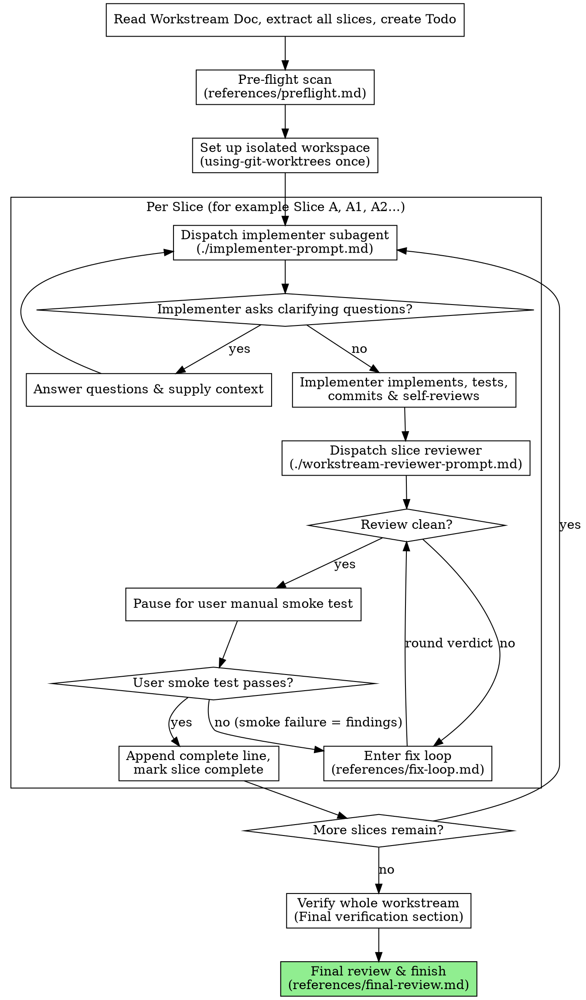

# Workstream-Driven Development

Execute a Workstream Document by dispatching a fresh subagent per slice, with a combined review after each: one reviewer returns both a compliance verdict and a quality verdict.

**Why subagents:** You delegate slice-level execution to specialized agents with isolated contexts. By precisely crafting their instructions, task details, and relevant file contexts, you ensure they stay focused and succeed. They should never inherit your full session history—only the curated slice requirements and file definitions.

**Core principles:**

Slice IDs use the grammar `[A-Z][0-9]*`: an uppercase letter followed by zero or more digits. For example, `A`, `A1`, and `A2` are valid IDs and are matched exactly; the IDs do not establish ordering.

1. **Single Git Worktree**: The entire workstream is executed within a single, isolated git worktree folder. We use the `using-git-worktrees` skill ONCE at the start of the workstream, and `finishing-a-development-branch` ONCE after the final slice is fully verified and completed. We do NOT create separate worktrees for each slice.
2. **Sequential Slice Execution**: Slices (for example, Slice A, A1, and A2) are completed one by one in document order.
3. **Curated Input**: The controller (you) extracts the slice goal, tasks, watch-outs, verification, manual smoke test steps, and carry-forward from the Workstream Document, presenting a highly focused prompt to the worker subagent.
4. **Combined Review**: For every slice, one reviewer checks both requirements compliance and code quality in a single pass, returning separate verdicts for each.
5. **Pause After Review Pass**: Preserve the worker ↔ reviewer retry loop until the slice achieves **review clean** (see [references/fix-loop.md](references/fix-loop.md)). Only after the slice is review clean do you write the awaiting-smoke-test ledger line and pause for the user's manual smoke test for that slice.

## When to Use

Use this skill when you have an approved **Workstream Document** (e.g., in `docs/workstreams/YYYY-MM-DD-<topic>.md`) and are ready to begin implementation.

## The Process

*Diagram labels describe workflow roles; see Harness Dispatch section below for how to dispatch on your harness.*

## Prompt Templates and Scripts

The following templates and helper scripts are stored in this skill's directory:

- `implementer-prompt.md` - Dispatch prompt for the implementer subagent.
- `workstream-reviewer-prompt.md` - Dispatch prompt for the slice reviewer subagent.
- `re-review-prompt.md` - Scoped re-review prompt used during fix loops.
- `bash scripts/slice-brief WORKSTREAM_FILE SLICE_ID` - Extracts a single slice into an isolated brief file.
- `bash scripts/review-package BASE HEAD <workspace-slug> WORKSTREAM_FILE` - Generates a unified diff package for reviewers.
- `bash scripts/wsd-workspace WORKSTREAM_FILE` - Resolves the disambiguated workstream workspace directory.

## Supporting References

Detailed procedures that the controller reads fresh at specific workflow steps live in `references/`:

- [references/preflight.md](references/preflight.md) - Pre-flight scan for cross-slice contradictions before dispatching Slice 1.
- [references/fix-loop.md](references/fix-loop.md) - Bounded 4-round fix loop, cap escalation to the human, and test rules.
- [references/final-review.md](references/final-review.md) - Final whole-workstream review, no second fix wave, and cleanup.
- [references/resuming.md](references/resuming.md) - Durable progress ledger, workspace identity, header parsing, and session resume.
- [references/handling-reports.md](references/handling-reports.md) - Handling non-DONE worker statuses (`BLOCKED`, `NEEDS_CONTEXT`, `DONE_WITH_CONCERNS`).
- [references/cannot-verify.md](references/cannot-verify.md) - Resolving "⚠️ Cannot verify from diff" reviewer items.

## Required Sub-skills

Worker subagents MUST be configured to use:

- `solopowers:test-driven-development` - Mandatory for every slice. The worker must follow a real red → green cycle and provide evidence for it in the slice report.

## Roles and Model Selection

- **Controller (You)**: Oversees execution, manages slice-to-slice state, updates the Todo task list, curates file contexts, and coordinates reviews. (Most capable model).
- **Implementer subagent:** Focuses entirely on implementing and testing a single slice. (Fast, cheap model for mechanical/isolated tasks; standard model for complex integrations).
- **Slice Reviewer subagent:** Evaluates requirements compliance AND code quality in a single pass. Returns separate verdicts: spec compliance (✅/❌/⚠️) and slice quality (Approved/Needs fixes). (Capable standard or premium model).

Always specify the model explicitly when dispatching a subagent. An omitted model silently inherits the controller's session model, which is often more expensive than needed.

**Turn count beats token price.** Wall-clock and context cost scale with how many turns a subagent takes, and the cheapest models routinely take 2-3× the turns on multi-step work — costing more overall. Use a mid-tier model as the floor for reviewers and for workers working from prose descriptions. When the slice brief contains the complete code to write, the implementation is transcription plus testing: use the cheapest tier for that worker. Single-file mechanical fixes also take the cheapest tier.

## Harness Dispatch

Use the table below to dispatch implementer and reviewer subagents on your harness:

| Harness | Dispatch implementer | Dispatch reviewer |
|---|---|---|
| Pi | built-in `worker` role | built-in `reviewer` role |
| kiro-cli | `orchestrate_subagent(role: general-task-execution)` | `orchestrate_subagent(role: semantic_reviewer)` |
| claude-code | `Task` tool with implementer prompt | `Task` tool with reviewer prompt |
| Antigravity | describe the implementation task in natural language; harness spawns dynamically | describe the review task in natural language; harness spawns dynamically |

### Escalation (subagent needs controller input mid-task)

| Harness | How to escalate |
|---|---|
| Pi | `contact_supervisor` MCP tool |
| kiro-cli | surface the question in response; controller resumes |
| claude-code | surface the question in response; controller resumes |
| Antigravity | subagent reports back; controller resumes with answer |

## Handling Worker Status

Worker subagents report one of four statuses: `DONE`, `DONE_WITH_CONCERNS`, `NEEDS_CONTEXT`, or `BLOCKED`. For complete handling instructions for non-DONE statuses, read [references/handling-reports.md](references/handling-reports.md).

When `DONE`: Generate the review package (`bash scripts/review-package BASE HEAD <workspace-slug> WORKSTREAM_FILE`) and dispatch the slice reviewer.

## Execution Flow

### 1. Initial Set Up (Start of Workstream)

- Use the `using-git-worktrees` skill to verify/create an isolated git worktree for the entire workstream.
- Read the Workstream Document at `docs/workstreams/YYYY-MM-DD-<topic>.md` and extract all slices.
- Resolve the workspace with `bash scripts/wsd-workspace WORKSTREAM_FILE`, which records the Workstream Document path in the ledger header and disambiguates if another workstream used the same slug.
- Run the pre-flight scan across all slices (see [references/preflight.md](references/preflight.md)) to catch cross-slice contradictions or contract conflicts before dispatching Slice 1.
- Create a `todo` task list with one task per slice, plus a final task for "Final verification and close branch".
- Check for a durable progress ledger before dispatching (see [references/resuming.md](references/resuming.md)). If the ledger already marks a slice complete, do not re-dispatch it.

### 2. Dispatching the Worker

For each slice, dispatch the worker subagent using file handoffs:

- Generate a slice brief with `bash scripts/slice-brief WORKSTREAM_FILE SLICE_ID` and pass the printed file path to the worker. `SLICE_ID` must match `[A-Z][0-9]*` (e.g., `A`, `A1`, `A2`).
- Explicitly inject `solopowers:test-driven-development` into the worker dispatch.
- **Test execution rule:** Run covering tests per fix round; run the full repository test suite before reporting slice DONE and before final workstream review.
- Provide the Workstream Objective, in-scope details, and carry-forward context from the preceding completed slice.
- Name a report file path for the worker so detailed notes and test evidence live on disk, not in controller context.
- Provide only the relevant code files or interfaces for this slice.

**Context budget:** The curated prompt must fit comfortably in a small context window. If a slice's brief + carry-forward + files exceed what a lightweight model can hold, escalate to the user — the slice is too large and needs splitting in the Workstream Document.

### 3. Reviewing the Slice

- Once the worker reports `DONE` or `DONE_WITH_CONCERNS`, generate a diff package with `bash scripts/review-package BASE HEAD <workspace-slug> WORKSTREAM_FILE` and dispatch the reviewer subagent.
- The reviewer checks the diff and reported TDD evidence, returning two verdicts in one report: spec compliance (✅/❌/⚠️) and slice quality (Approved/Needs fixes).
- If the reviewer reports "⚠️ Cannot verify from diff", resolve it yourself from context before marking the slice review clean (see [references/cannot-verify.md](references/cannot-verify.md)).
- If the reviewer flags issues: enter the bounded fix loop (see [references/fix-loop.md](references/fix-loop.md)). Re-read `references/fix-loop.md` before every fix round.
- **Manual Smoke Test Pause**: Only after the slice achieves **review clean** (see [references/fix-loop.md](references/fix-loop.md)), append `Slice <ID>: review clean (commits <base7>..<head7>) — awaiting smoke test` to the progress ledger, then pause and ask the user to run the slice's manual smoke test from the Workstream Document. Do not continue to the next slice until the user confirms the smoke test passed.
- After the user confirms the smoke test passed, append `Slice <ID>: complete (commits <base7>..<head7>, review clean[, <K> user rulings], smoke test passed)` to the ledger and mark the slice complete in the Todo list.
- If the user reports a smoke test issue, append `Slice <ID>: smoke test failed (at <head7>) — <one-liner>` to the ledger and enter the fix loop with a fresh 4-round budget with `FIX_BASE` = `<head7>` (from the preceding `review clean` line) and the user's report as findings (see [references/fix-loop.md](references/fix-loop.md)).

### 4. Transitioning and Finalization

When all slices are marked complete and smoke-tested:
- Follow the final review procedure in [references/final-review.md](references/final-review.md): run the **Final verification** commands, generate the whole-branch review package, dispatch the final codebase reviewer (`solopowers:dispatching-code-review`), clean up the workspace directory, and invoke `solopowers:finishing-a-development-branch`.

## File Handoffs

Everything pasted into a prompt or returned by a subagent stays resident in your context for the rest of the session. Prefer artifacts on disk:

- **Slice brief:** `bash scripts/slice-brief WORKSTREAM_FILE SLICE_ID` extracts one slice into its own file.
- **Worker report:** Give each slice a report file path. The worker writes the full report and test evidence there, returning only status, commits, test summary, concerns, and the report path.
- **Review package:** `bash scripts/review-package BASE HEAD <workspace-slug> WORKSTREAM_FILE` writes the commit list, stat summary, and diff context into one file.

## Constructing Reviewer Prompts

Per-slice reviews are slice-scoped gates; the broad review happens once at the final whole-workstream review. When filling the reviewer template:

- Do not add open-ended directives like "check all uses" or "run race tests if useful" without a slice-specific reason.
- Do not ask a reviewer to re-run tests the worker already ran — the worker's report carries the test evidence.
- Do not pre-judge findings — never instruct a reviewer to ignore or not flag a specific issue. If the prompt contains "do not flag," "don't treat X as a defect," or "the workstream chose" — stop: you are pre-judging.
- Copy binding requirements verbatim from the Workstream Document's Slice header into the global-constraints block.
- Pass the diff as a file using `bash scripts/review-package BASE HEAD <workspace-slug> WORKSTREAM_FILE` with the recorded `BASE` commit (never `HEAD~1`).
- Do not paste accumulated prior-slice history into later dispatches.
- Dispatch fix subagents for Critical and Important findings. Record Minor findings in the progress ledger as deferred minors.
- Findings labeled workstream-mandated are the user's decision: present the finding and the workstream text to the user.

## Durable Progress and Session Resume

Conversation memory does not survive compaction. Track durable progress in `$(bash scripts/wsd-workspace <workspace-slug> WORKSTREAM_FILE)/progress.md`.

For complete details on ledger header tracking, collision disambiguation (`<slug>-<date>[-N]`), legacy ledger adoption, and step-by-step resume instructions, read [references/resuming.md](references/resuming.md).

- Write `Slice <ID>: review clean (commits <base7>..<head7>) — awaiting smoke test` immediately when review clean is achieved, before pausing for the smoke test.
- Write `Slice <ID>: complete (commits <base7>..<head7>, review clean[, <K> user rulings], smoke test passed)` immediately after the user confirms the smoke test passed. Slices with a `complete` line are DONE — do not re-dispatch them.
- On resume, read the ledger, inspect git log in the worktree, and resume execution per the state table in [references/resuming.md](references/resuming.md).

## Red Flags / Anti-patterns

- **Creating a new worktree per slice**: Absolutely NOT. Keep everything in one worktree for the entire workstream.
- **Letting subagents read the Workstream Doc**: Subagents should NOT read the Workstream Doc. Provide the curated text and tasks for their specific slice to protect their context window.
- **Treating TDD as optional**: Do not dispatch workers without `solopowers:test-driven-development`, and do not accept "tests added later" as equivalent to a real red → green cycle.
- **Proceeding while a slice review fails**: Never start the next slice while there are open review findings in the current slice.
- **Skipping the manual smoke test pause**: Never continue to the next slice once review passes without pausing for the user's manual smoke test.
- **Failing to commit**: Ensure each slice is committed before starting reviews, and any fixes are also committed.
